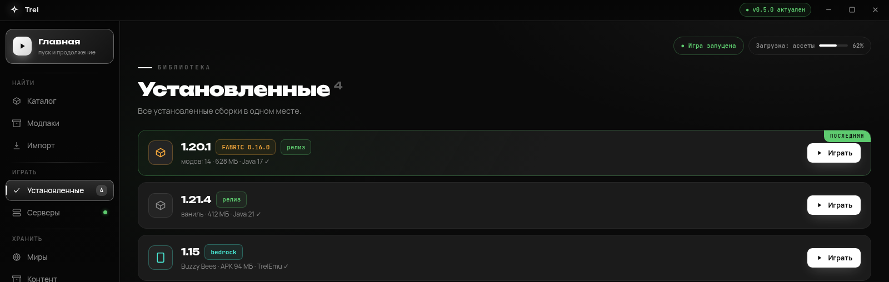
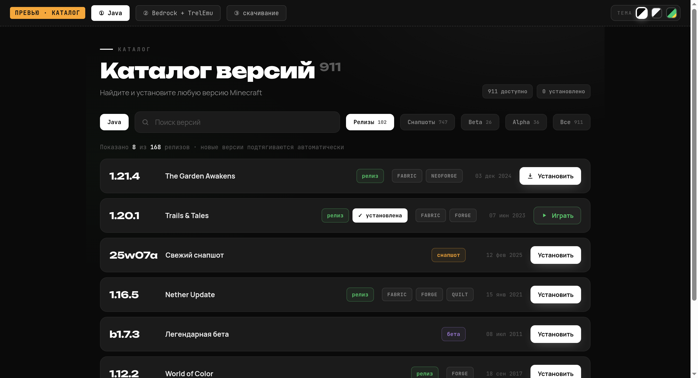

<p align="center">
  <a href="README.md"></a>
  <a href="README.ru.md"></a>
</p>

# Trel

[](https://github.com/Griln/Trel/releases/latest)
[](https://github.com/Griln/Trel/actions)
[](LICENSE)
[](https://github.com/Griln/Trel/releases/latest)

Лаунчер Minecraft для Windows и Linux. Каталог Java- и Bedrock-версий, модлоадеры, моды, миры, серверы, скины и импорт из других лаунчеров. Без рекламы и регистрации: можно играть гостем или войти через Microsoft.

## Скриншоты




## Что умеет

### Любая версия Minecraft в один клик
От самой первой rd-132211 до новейшего снапшота. Релизы, снапшоты, бета, альфа — всё в одном каталоге, ставится в один клик. Список обновляется сам — новые версии появляются без перезапуска.

### Моды без головной боли
Поддерживаются **Fabric**, **Quilt**, **Forge** и **NeoForge** — основные мод-загрузчики. Установка автоматическая, в каталоге выбираешь нужную версию Minecraft и ставишь поверх неё лоадер.

### Каждая версия — со своими модами
Поставил Fabric на 1.20.1 со своим набором модов, потом Forge на 1.18.2 с другими — они не пересекаются. У каждой установленной версии своя папка с модами, шейдерами, ресурс- и текстур-паками. Можно держать сколько угодно сборок параллельно и переключаться между ними.

Если передумал и хочешь сыграть в чистую ваниль — кнопка «Вернуть к ванили» уберёт лоадер и вернёт всё в исходное состояние, моды никуда не денутся.

### Шейдеры и ресурс-паки
Кидаешь `.zip` в раздел «Контент» — лаунчер сам кладёт куда надо. Можно включать/отключать моды по одному без удаления.

### Java сама поставится
Не нужно искать и качать нужную версию Java вручную. Лаунчер посмотрит, что уже установлено в системе, и если ничего подходящего не найдёт — скачает Eclipse Temurin под нужный Minecraft. Java 8 для старых, 17 для новых, 21 для свежих — всё разруливается само.

### Старые сейвы не теряются
Корректно работает с мирами от Pre-Classic до современных. Поддерживает миры в нестандартных местах (включая старый формат, когда мир хранился одним файлом `level.dat` без папки).

### Авто-обновления
Когда выходит новая версия лаунчера — он скачает её сам в фоне и предложит установить. Качается только то, что изменилось, а не весь файл заново.

### Никакой обязательной регистрации
Создаёшь гостевой профиль на лету: вводишь никнейм — играешь. Можно держать несколько профилей и переключаться. Также поддерживается вход через Microsoft: гость подходит для одиночной игры и серверов без проверки лицензии, Microsoft — для официальных серверов.

## Установка

Скачай [последний релиз](../../releases/latest).

Windows:
- **`Trel-x.y.z-x64.exe`** — обычный установщик. Поставится в `Program Files`, появится ярлык в Пуске, обновляется автоматически.
- **`Trel.exe`** — портативная версия. Ничего не устанавливает — запускается напрямую, данные хранит рядом, можно носить на флешке.

Системные требования Windows: **Windows 10 или 11**.

Linux:
- **`Trel-x.y.z-x86_64.AppImage`** — портативный запуск без установки.
- **`Trel-x.y.z-amd64.deb`** — Debian/Ubuntu.
- **`Trel-x.y.z-x86_64.rpm`** — Fedora/RHEL-подобные.

## Первый запуск

1. Запустить лаунчер.
2. Создать гостевой профиль или войти через Microsoft.
3. Открыть «Каталог», выбрать версию Minecraft, нажать «Играть».

Всё. Лаунчер сам скачает игру, нужные библиотеки и Java.

## Где хранятся данные

Windows: `%APPDATA%\Trel\` — настройки, аккаунты, скачанная Java, версии Minecraft, миры.

Linux: каталог данных Electron — обычно `~/.config/Trel`; в портативной сборке и в особых случаях может использоваться соседний каталог.

Путь к игровой папке можно поменять в настройках, если хочешь хранить версии и миры на другом диске.

## Разработка

Для разработчиков, которые хотят собрать лаунчер из исходников или поучаствовать.

```bash
npm install
npm run dev          # в одной консоли — Vite на localhost:5173
npm start            # в другой — запустит Electron
```

Сборка релизных бинарников:

```bash
npm run build        # проверка сборки без упаковки
npm run dist         # Windows: инсталлятор NSIS + портативная сборка
npm run dist:linux   # Linux: AppImage + deb + rpm
```

В `release/` появятся установщики/пакеты и файлы для автообновлений.

Стек: Electron 33, React 18, TypeScript, Vite, electron-builder, [@xmcl/core](https://github.com/Voxelum/minecraft-launcher-core-node) для работы с Minecraft.

## Лицензия

[MIT](LICENSE).

## Важно

Minecraft — собственность Mojang/Microsoft. Trel не предоставляет игру и не обходит лицензию: клиент скачивается с официальных серверов Mojang. Запускать без купленного аккаунта можно только в одиночной игре и на серверах, где отключена проверка лицензии (`online-mode=false`). Для игры на официальных серверах нужен Microsoft-аккаунт — вход через него поддерживается.

## Помочь проекту

- 🐛 [Нашёл баг](https://github.com/Griln/Trel/issues/new/choose) — приложи лог из «Настройки → Диагностика»
- 💡 [Есть идея](https://github.com/Griln/Trel/issues/new/choose)
- 💬 [Вопросы и обсуждения](https://github.com/Griln/Trel/discussions)
- 🧑‍💻 [Хочу контрибьютить](CONTRIBUTING.md) — как собрать и запустить тесты
- 🔒 [Уязвимость](SECURITY.md) — не в issue, а по инструкции оттуда
- 📜 [Правила поведения](CODE_OF_CONDUCT.md)

## Релизы

Релизы собираются и публикуются автоматически: пушишь тег — CI собирает
Windows (инсталлятор NSIS и портативная сборка) и Linux (AppImage, deb, rpm) и прикрепляет файлы
к релизу.

```bash
# номер версии в теге должен совпадать с полем version в package.json
git tag vX.Y.Z
git push origin vX.Y.Z
```

Зеркало релизов и эмулятора TrelEmu: [archive.org](https://archive.org/details/trel-emu-pack-v0-5-0).

